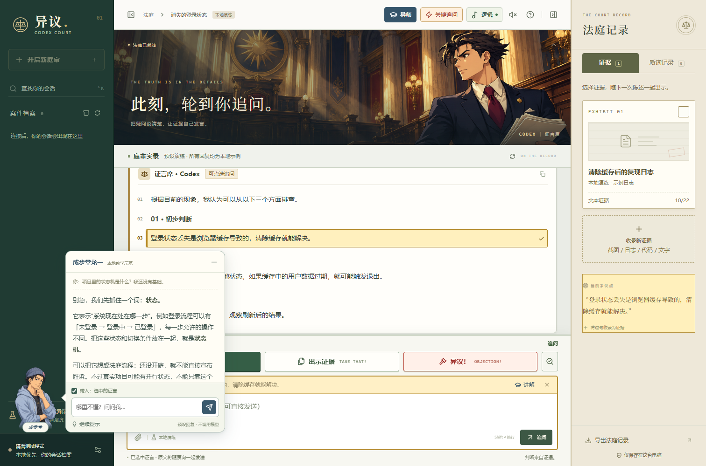

# 异议 · Codex Court

一个在本机运行的《逆转裁判》风格 Codex 客户端。沿用已安装 Codex 的登录、配置和本地会话，通过官方 App Server 协议工作，无须额外 API Key。


## 一键使用（Windows）

1. 在自己的电脑上安装并登录 Codex，安装 Edge 或 Chrome。
2. 从 [最新发布](https://github.com/bjckbjckbjck-ai/codex-court/releases/latest) 下载 `codex-court-1.3.1-win-x64.zip`，**完整解压**到可写目录。
3. 双击 **Start-Court.cmd**。便携版自带 Node.js 和构建好的界面，无须安装开发工具或填写额外 API Key。以后可双击 **启动法庭.vbs** 静默打开。

客户端使用这台电脑上 Codex 的登录和会话，不连接发布者的电脑。它是独立的法庭风格客户端，不修改官方 Codex 窗口；可随时回到官方客户端。ZIP 不包含发布者的账号、密钥、历史、证据或浏览器资料。不要将本地服务暴露到公网。

它会启动本地服务，并使用 Edge（或 Chrome）打开一个独立应用窗口。该窗口使用本项目自己的浏览器用户目录，不接触日常浏览器资料。

服务地址：<http://127.0.0.1:4317>

### 从源码启动

下载仓库 ZIP 并解压，或克隆本仓库，再双击 **Start-Court.cmd**。第一次会通过 `npm ci` 安装锁定的依赖并构建；没有 Node.js 22+ 时，会从 nodejs.org 下载固定版本、校验 SHA-256 后安装到项目的 `.local/runtime/`，不改系统 PATH。这一步需要网络。Windows ARM64 可使用此方式。

也可以手动执行（需要 Node.js 22+）：

```powershell
npm ci
npm run build
npm start
```

已构建的客户端启动时只依赖 Node.js 的内置模块；浏览器资源保存在 `dist/` 中，不从 CDN 加载。

1.1.1 修复桌面快捷方式启动后“未找到本机 Codex”的问题：除了系统 PATH，还会自动查找 `%LOCALAPPDATA%\OpenAI\Codex\bin` 下的已安装版本。每次重新连接都会重新检测，不写死更新目录；自定义位置仍可使用 `CODEX_BINARY`。

## 如何使用

1. 左侧选择原有会话，也可以先进入 **练习庭 · 第一次异议**。练习庭使用预设本地回复，不调用模型。
2. 点击 Codex 的一句话，或用鼠标划选其中的一部分。原句和来源消息会绑定到本次质询。
3. 点击 **追问 / 出示证据 / 异议 / 要求验证**，可补充理由后发送。
4. 证据面板支持文本、日志、代码文件以及 PNG / JPEG / WebP / GIF 图片。勾选要出示的证据，再发送；图片会作为真正的图片输入传给 Codex。
5. **质询记录**保留原句、证据名称及 SHA-256 指纹，并链接到对应回复。复核状态由你手动标记，客户端不会自动宣称“异议成立”。
6. `Enter` 发送、`Shift + Enter` 换行、`Esc` 取消选句、`Ctrl + K` 查找会话。动画及音效可以单独关闭。

右上角可收起法庭场景与侧栏。客户端支持窄窗口布局。证据和质询记录可导出为 JSON。

### 1.1 界面与演出

你的陈述使用绿色卡片；Codex 的证言使用金边白色卡片；选中的语句以黄色高亮，异议输入区使用红色提示。发送追问、出示证据、异议或验证时，会立即出现约 1.8 秒的全屏字卡。设置 → **演出与连接** 可以预览四种演出，预览不会发送消息。系统启用“减少动态效果”时，改用静态字卡。音效与动画可分别关闭。

### 成步堂助手 · 1.3.1

右上角 **导师** 会叫出四代成步堂形象的小助手。拖动人物可以换位置，点击人物展开或收起对话气泡；位置会记住，缩小窗口时自动移回可见区域。默认待在左下方，给证据侧栏留出空间；放大查看证据时助手暂时让开，关闭证据后恢复。

- 界面只保留提问、**继续提示**和收起；回复在人物旁的气泡里显示，长内容可以滚动。`Esc` 收起气泡，人物仍在；人物旁的 × 关闭助手。人物获得键盘焦点后，也可用方向键微调位置。
- 选中证言点 **讲解**，或在证据检视中点 **请导师带我看**，即可带入文本或图片。勾选的“带入”材料会随问题发送，可取消勾选；打开助手本身不调用模型。
- 用一句白话说明概念，结合项目或生活例子拆解难点，再给一个小检查。点 **继续提示**逐步获得线索，也可以直接输入“再简单一点”“一步步教我”等要求。
- 教学使用独立的 Codex 会话，沿用你自己的登录和额度，不向原工作会话追加教学消息。项目中的导师跟随原会话目录，以只读方式查看代码；从首页进入可自由提问。
- 复杂的知识卡、偏好和教学模式面板暂时收起。原有学习记录、知识卡及偏好仍保存在本地；重新打开助手可接着上次对话学习。
- 练习庭中的导师是明确标注的本地示范；真实项目和首页学习连接本机 Codex。导师是角色化 AI，并非官方角色服务，回答仍需结合实际材料检验。



### 证据检视与配乐 · 1.3

点开证据卡后，材料会在中央放大：支持图片/文字缩放、文本查找高亮和来源指纹查看，也能直接交给导师讲解。自动配乐开启时，证据检视或展开的导师气泡使用 **逻辑** 曲；关闭证据、收起气泡后恢复当前庭审配乐，保留暂停状态。只有小人物常驻时不会占用逻辑配乐；关闭自动切换时不干预手动选曲。

**询问（慢）** 和 **询问（快）** 分别配置。右上角 **关键追问** 可切换；已配置快版时，带证据追问也会进入快节奏。默认慢版沿用已有曲目，快版曲位留空等待导入，不使用追求曲代替。曲名含“询问（快）”、Allegro、アレグロ的导入文件会识别到快版；Moderato、モデラート归入慢版。

### 导入与分配 BGM

首次启动自动载入 **逆转裁判 4** 的 8 首录音，预设开庭、慢询问、异议、追求、调查、思考、休庭和胜诉；逻辑环节默认使用 BGM04。默认曲目约 6.6 MiB，来源与说明见 [音乐包说明](assets/music/NOTICE.md)。浏览器可能要求先点击一次播放。

已有音乐库和偏好不会被默认包覆盖；删除默认曲目后，重启也不会重新添加。默认包以外的版本仍可自由导入。点击右上角 **配乐**，或设置 → **背景音乐**：

1. 在“导入到版本”选择逆转裁判 1–6、逆转检事 1–2、大逆转裁判 1–2，也可以填写自己的版本名称。
2. 批量选择或拖入 MP3 / OGG / WAV / FLAC / M4A / AAC / OPUS 文件，单曲最多 64 MB。音乐会复制到本机音乐库，原始文件不变。实际解码支持取决于浏览器；有问题的文件会显示播放提示。
3. 曲名中的“尋問 / Cross-Examination”“異議 / Objection”“追求 / Pursuit”等会被识别并填入对应空位；已有分配不会被覆盖。没有识别出的曲目仍然会入库，可手动分配。
4. 在“环节配乐”设置开庭、询问、异议、追求、调查、思考、休庭、胜诉各环节。每个版本分别保存设置，也支持混用其他版本的曲目。留空表示不播放。
5. 开启背景音乐，可调音量、暂停、试听、手动切换环节，或开启“随庭审自动切换”。试听不需要开启自动 BGM；结束试听会恢复原来的播放状态。
6. 曲目库支持搜索、修改曲名/版本/分类和移除。移除本机副本会同时清空引用它的分配；不会删除你原来的音频文件。

自动配乐：进入会话播放开庭 8 秒后转入询问；点选证言或追问进入询问；出示证据/要求验证进入调查；普通消息等待回应时进入思考；发送异议播放异议 8 秒后进入追求；返回首页/暂停回应进入休庭。胜诉只手动播放。浏览器若阻止自动播放，点击播放按钮即可。

设置 → **原声目录** 收录官方专辑与音乐鉴赏入口，分别标明类型；不自动下载音乐。详细来源见 [docs/music.md](docs/music.md)。

## 共用会话的边界

- 使用当前 `CODEX_HOME`；默认读取 `%USERPROFILE%\.codex`。会话通过 `thread/list`、`thread/read`、`thread/turns/list` 和 `thread/resume` 接入，不复制或直接修改原会话数据库。
- 发送的追问和模型回答进入原会话，因此会消耗当前 Codex 模型对应的额度。
- **同一会话一次由一个客户端写入。** 官方客户端仍持有写入锁时，本客户端不能强行接管。请先结束原任务并释放会话，必要时退出原客户端，再到法庭客户端继续。只浏览历史不需要接管。
- 要回到官方客户端，先结束当前回应，在设置中点击 **交还会话给原 Codex**。这会关闭本客户端自己的 App Server 连接，保留全部会话历史。需要继续使用时点击“重新连接”。
- 接入相同本地历史不等于两个客户端实时镜像。本客户端提供刷新和历史分页；远程主机、云端 Work 聊天以及桌面专属工具不在首版兼容范围内。
- 会话里的桌面动态工具请求如果无法执行，会明确返回“不支持”，不会伪造执行成功。Codex 自带的命令、文件工具及可用 MCP 工具仍交给 Codex 运行。
- 新建会话使用项目目录写入权限，额外权限请求显示在聊天区。续接会话保留原有配置，模型和思考强度可在输入栏切换。

## 数据与进程

| 内容 | 位置 |
| --- | --- |
| 原始 Codex 会话 | 当前 Codex 的数据目录，不迁移 |
| 证据与质询附加记录 | `.local/court.json` |
| 导师会话关联、知识卡与学习偏好 | `.local/court.json.mentor.json` |
| 音乐库、版本分配与播放偏好 | `.local/court.json.music/library.json` |
| 导入的音频副本 | `.local/court.json.music/`，使用随机文件名 |
| 独立窗口的浏览器资料 | `.local/app-browser-profile/` |
| 服务日志 | `.local/server.stdout.log` / `.local/server.stderr.log` |
| 原创法庭插画 | `public/assets/courtroom.png` |

关闭法庭窗口后，本地服务可继续运行，便于不中断正在进行的回复。如需彻底停止，先结束或暂停回应，再双击 **停止法庭服务.vbs**。只关闭该服务启动的 Codex 子进程，不操作官方客户端或日常浏览器。

本地服务仅监听 `127.0.0.1`。接口检查 Host、Origin、会话 Cookie 与写入凭据。原始模型日志、隐藏推理及认证密钥不传给网页。证据只有在你选择并发送后才会进入 Codex 消息。

### 可选环境变量

| 变量 | 用途 |
| --- | --- |
| `PORT` | 服务端口，默认 `4317`；一键启动脚本固定使用该端口 |
| `CODEX_BINARY` | 指定已安装的 Codex 可执行文件 |
| `DATA_FILE` | 指定法庭附加记录文件，用于隔离测试 |
| `CODEX_COURT_PROXY=1` | 有共享 App Server 控制端口时使用官方 stdio proxy；默认关闭 |
| `COURT_TEST_MODE=1` | 不启动 Codex 的隔离测试模式，必须同时设置独立 `DATA_FILE` |

## 验证与开发

```powershell
npm test
npm run test:ui
npm run test:mentor
npm run probe
```

发布检查使用 `node scripts/check-public.mjs`（扫描 Git 暂存内容，不打印秘密值）。便携包构建：先 `npm ci`、`npm run build`，再执行 `powershell -NoProfile -ExecutionPolicy Bypass -File scripts/package-release.ps1`。打包使用明确文件白名单，输出到被 Git 忽略的 `.local/releases/`。

`node scripts/test-release.mjs <解压目录>` 使用包内 Node.js，在独立存档上验收默认配乐和真实音频解码。所有测试输出在被忽略的 `test-results/`。

`test:ui` 从终端运行独立 Playwright，为 Chrome、Edge 各创建临时用户目录，连接独立测试数据服务。覆盖选句、追问、举证、异议、记录保存、文件导入、移动布局和跨站请求保护，并采集截图及控制台错误。测试结束仅清理自己创建的进程和临时目录。

1.1 同时覆盖演出预览与减少动画模式、真实音频播放、批量导入、版本独立分配、异议到追求的自动切换、音量和刷新持久化、暂停、删除清理及音频 Range 请求。`DATA_FILE` 对应的音乐目录是该路径加 `.music`，测试音乐与正式音乐库完全隔离。

`node scripts/smoke-live.mjs` 是可选真实连接验收：使用现有 ChatGPT 登录创建不落盘的临时会话，发送一条简短消息。它消耗一次少量 Codex 用量，不修改任何已有会话。

`node scripts/test-mentor-live.mjs` 可选验证真实导师：使用现有 ChatGPT 登录、不落盘的临时会话及临时示例项目，只读讲解一个代码概念，检查源文件没有变化。会消耗一次模型回应的额度。

升级时先停止法庭服务，保留完整 `.local` 目录，再更新程序文件；便携 ZIP 也可解压到新目录后复制自己的 `.local`。源码升级后执行 `npm ci`、`npm run build`。首次加载会把旧“思考”曲的分配复制到新“逻辑”曲位；已有偏好不覆盖，之后主动清空也不会重填。

开发模式：先启动本地服务（可设置 `COURT_DEV=1`），再运行 `npm run dev`。构建执行 `npm run build`。协议定义可用 `codex app-server generate-ts --out .generated/protocol` 按本机版本生成。

设计与素材来源见 [docs/design.md](docs/design.md)，实现与限制见 [docs/architecture.md](docs/architecture.md)。
